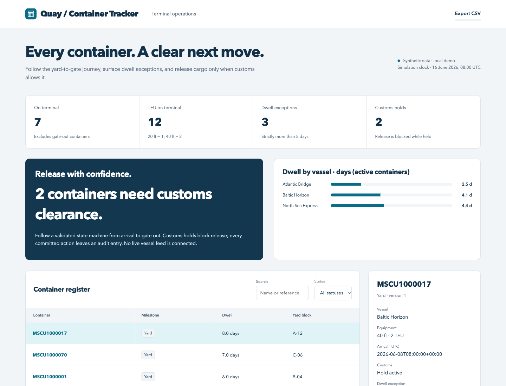

# Quay / Container Tracker

A terminal operations simulation with ISO 6346 checks, customs-gated release, dwell exceptions and an auditable arrival-to-gate journey.

[](https://github.com/phlppgdfry/port-container-tracker/actions/workflows/demo.yml)



## Run it in one command

Requires Python 3.11+ with SQLite support. No pip install, account, API key or Node runtime is needed to run the application.

```bash
git clone https://github.com/phlppgdfry/port-container-tracker.git
cd port-container-tracker
python3 -m demo.server
```

Open **http://127.0.0.1:8112**. The first start seeds `var/demo.sqlite3`; later starts preserve changes. The server binds to loopback only.

Use a new database path for a fresh workspace, without overwriting existing work:

```bash
python3 -m demo.server --port 8212 --db var/fresh-demo.sqlite3
```

## Try the complete workflow

1. Select MSCU1000017 and try to release it. The active customs hold blocks the transition.
2. Enter a fictional customs clearance reference, clear the hold, release the container, then record gate out.
3. Reload and select the same identifier. Its completed journey and frozen dwell remain available; inspect the activity log.

Search and status filtering, record inspection, CSV export, input errors, an activity log, responsive layouts, individual SVG branding, favicons and Apple touch icons are included.

## Why this project exists

Terminal teams need to distinguish a long-dwelling container from a container that is actually eligible for release.

The implementation completes one demonstrable product slice, with explicit business rules and verifiable state changes. This is a **local portfolio demonstration with synthetic data**, not an operating service or evidence of client outcomes.

## Business rules

- State machine: arrived → yard → released → gate_out. No skipping, backward transition or transition after gate out.
- A customs hold blocks yard → released. Clearing it requires a non-empty reference, recorded on the container.
- Dwell is measured in elapsed 24-hour days; an active exception is strictly >5 days. Departed containers use the departure timestamp, not the current simulation clock.
- ISO 6346 category and check digit are validated before mutation. Fixtures are checksummed identifiers for simulation, not evidence of real container ownership.

## Verify and reproduce

```bash
make check                 # domain, HTTP, transaction and concurrency tests + syntax checks
make report                # deterministic baseline JSON and CSV; does not modify the database
```

Node 24+ is used only for JavaScript syntax checks and browser verification. The browser suite has a pinned development dependency:

```bash
npm ci
npx playwright install chromium
npm run test:e2e
```

The six Chromium tests start an isolated Python server and temporary database, then clean it up. They cover branding/assets, filtering, 390/768/1440 px widths and the complete domain workflow. GitHub Actions also runs Python tests on 3.11 and 3.14. See [validation evidence](docs/validation.md).

Baseline evidence is committed in [reports/baseline/snapshot.json](reports/baseline/snapshot.json) and [records.csv](reports/baseline/records.csv). These are generated from the fixtures, not a screenshot of arbitrary runtime state.

## Engineering decisions

**Model transitions explicitly.** The server derives the next state. The browser cannot submit an arbitrary destination state or bypass a customs hold.

**Freeze the operational clock.** Dwell and fixture metrics are reproducible. This simulation represents 16 June 2026 at 08:00 UTC.

**Archive the disconnected prototype.** The original Java/Groovy/Oracle samples and duplicate frontends are retained under docs/archive. The runnable product has a single documented entry point.

The browser uses semantic HTML, native JavaScript modules and CSS. The Python application separates input contracts, domain rules, transactional persistence and HTTP transport. Records use optimistic version checks; each mutation and its audit entry commit together. Rejected actions leave both unchanged.

## Scope and evidence

No terminal operating system, EDI endpoint, AIS/vessel feed, real customs clearance or Oracle warehouse is connected. Clearing a hold is a simulation action in one trusted local workspace.

The June concept is retained in [original-concept.md](docs/original-concept.md), explicitly labelled as unverified history. Current functionality is defined by the source, tests and this README. The demo has no authentication or tenant boundaries; use fictional data and keep it local.

## Explore the repository

| Resource | Purpose |
| --- | --- |
| [demo/domain.py](demo/domain.py) | Fixtures, calculations and use cases |
| [demo/store.py](demo/store.py) | SQLite transactions, optimistic versions and audit log |
| [demo/web/feature.js](demo/web/feature.js) | Domain-specific forms and details |
| [tests](tests) | Domain, persistence, HTTP and browser verification |
| [Architecture](docs/architecture.md) | Boundaries, tradeoffs and data flow |
| [API contract](docs/api.md) | Routes, payloads and errors |
| [Case study](docs/case-study.md) | Problem, acceptance criteria and delivery scope |
| [Runbook](docs/runbook.md) | Start, inspect, export and recover |
| [Mobile preview](docs/mobile.png) | 390 px workspace |

Built by [Philippe Godfroy](https://github.com/phlppgdfry).
